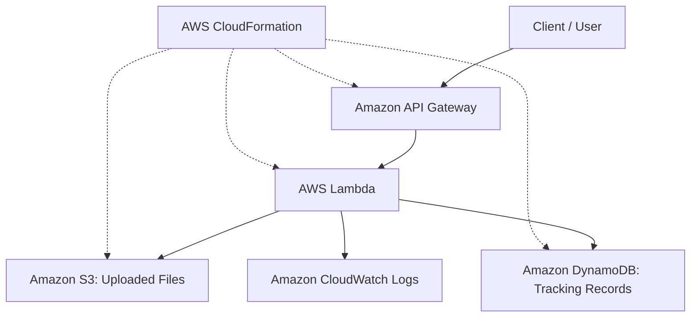

# Serverless File Processing and Tracking System

## Project Overview
An AWS serverless application for uploading text files and tracking processing status.

## Architecture
- Amazon API Gateway exposes upload and status endpoints.
- AWS Lambda processes requests.
- Amazon S3 stores uploaded files.
- Amazon DynamoDB stores file tracking records.
- Amazon CloudWatch collects logs for troubleshooting.
- AWS CloudFormation defines the infrastructure as code.

## Deployment
Region: us-west-2

```bash
aws cloudformation deploy --template-file template.yaml --stack-name file-tracking-project --capabilities CAPABILITY_IAM --region us-west-2
```

## Test Evidence
Uploading demo.txt returned PROCESSED. The file was verified in S3, and its tracking record was verified in DynamoDB.

## Cleanup
After saving the required evidence, delete the CloudFormation stack to avoid ongoing charges.


