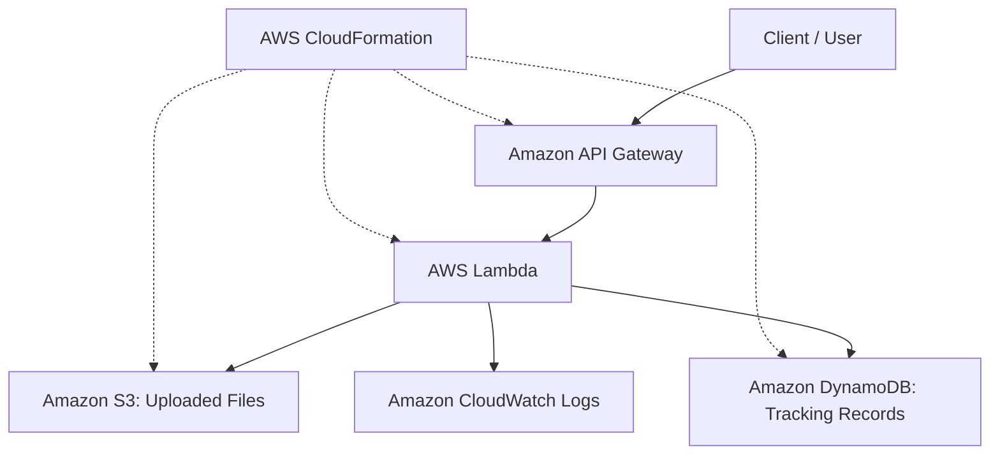

Serverless File Processing and Tracking System

Project Overview

This project is a serverless application built on AWS for uploading text files and tracking each text file's processing status. A user can submit a text file through an API, have the application store the file in Amazon S3, and retrieve its processing status from a tracking record stored in Amazon DynamoDB. The infrastructure is defined utilizing AWS CloudFormation, making it possible to deploy the application’s resources together as a stack.

Architecture
The diagram below illustrates the main components of the application and how they interact together:

AWS Services Utilized:

* Amazon API Gateway: Provides the API endpoints utilized to upload files and retrieve their status.
* AWS Lambda: Handles incoming requests, coordinates file storage and status tracking.
* Amazon S3: Stores the uploaded text files.
* Amazon DynamoDB: Stores the records utilized to track uploaded files and their processing status.
* Amazon CloudWatch Logs: Provides logs that can be utilized to troubleshoot Lambda executions.
* AWS CloudFormation: Defines and deploys the application’s infrastructure as code.

Prerequisites:
Before deploying the application, make sure you have:
* An AWS account with permission to create the resources defined in template.yaml.
* AWS CLI installed and configured with valid credentials.
* curl available in your terminal for testing the API.

Confirm that the AWS CLI is installed and your credentials are functioning:

aws --version
aws sts get-caller-identity

Deployment:

1. Clone the repository

Download the project and enter its directory:

git clone https://github.com/seneviratnemiyuru01-source/serverless-file-tracking-system.git
cd serverless-file-tracking-system

2. Deploy the infrastructure

The application is configured for the us-west-2 AWS region. Deploy the resources utilizing the CloudFormation template:

aws cloudformation deploy \
  --template-file template.yaml \
  --stack-name file-tracking-project \
  --capabilities CAPABILITY_IAM \
  --region us-west-2

CloudFormation creates or updates the resources defined in the template.

3. Retrieve the stack outputs

Once deployment has completed, retrieve the output values:

aws cloudformation describe-stacks \
  --stack-name file-tracking-project \
  --region us-west-2 \
  --query "Stacks[0].Outputs" \
  --output table

Utilize the returned values to identify the API endpoints and AWS resources for your deployment. These values are specific to the deployed stack, so they are not hard-coded into this README.

Utilizing the Application:

1. Upload a text file

The upload endpoint accepts a POST request with a JSON body containing the filename and text content.

Replace YOUR_UPLOAD_URL with the upload URL returned by CloudFormation:

curl -X POST "YOUR_UPLOAD_URL" \
  -H "Content-Type: application/json" \
  -d '{"filename":"demo.txt","content":"Hello from my serverless application."}'

The response contains information about the uploaded file, including its generated fileId and processing status. Save the returned fileId to utilize when checking the status.

2. Retrieve the file’s status

Use the status endpoint returned by CloudFormation and include the fileId from the upload response in the URL.

Replace YOUR_COMPLETE_STATUS_URL with the complete status URL for the file:

curl "YOUR_COMPLETE_STATUS_URL"

The response provides the tracking information for the requested file. Utilize the actual endpoint and file ID returned by your deployment and upload request.

3. Verify the stored data

After uploading a file, verify the result in AWS:

* Check Amazon S3 to confirm that the uploaded file exists.
* Check Amazon DynamoDB to confirm that the corresponding tracking record exists.
* Review Amazon CloudWatch Logs if you need to investigate Lambda execution or errors.

The CloudFormation outputs identify the resource names for your deployed stack.

Test Evidence:

During testing, demo.txt was uploaded and the application returned the status PROCESSED. The uploaded object was verified in Amazon S3, and its tracking record was verified in Amazon DynamoDB.

The evidence/ directory contains screenshots documenting the deployment and testing process.

Repository Contents:

* README.md — Project overview, architecture, prerequisites, deployment, usage, testing, and cleanup instructions.
* architecture.png — The standalone architecture diagram displayed above.
* template.yaml — AWS CloudFormation template defining the application’s infrastructure.
* evidence/ — Screenshots documenting deployment and testing.

Cleanup:

After saving the required screenshots and evidence, delete the CloudFormation stack to remove the deployed resources and help avoid ongoing charges.

aws cloudformation delete-stack \
  --stack-name file-tracking-project \
  --region us-west-2

Wait for the deletion to complete:

aws cloudformation wait stack-delete-complete \
  --stack-name file-tracking-project \
  --region us-west-2

Confirm that the stack has been deleted before considering cleanup complete.

AI Use Disclosure:

ChatGPT was utilized for technical explanations, debugging assistance and reviewing project documentation. I reviewed the information and made the final decisions about the project’s implementation and documentation.
AI Use Disclosure

ChatGPT was used for technical explanations, debugging assistance, and reviewing project documentation. I reviewed the information and made the final decisions about the project’s implementation and documentation.
